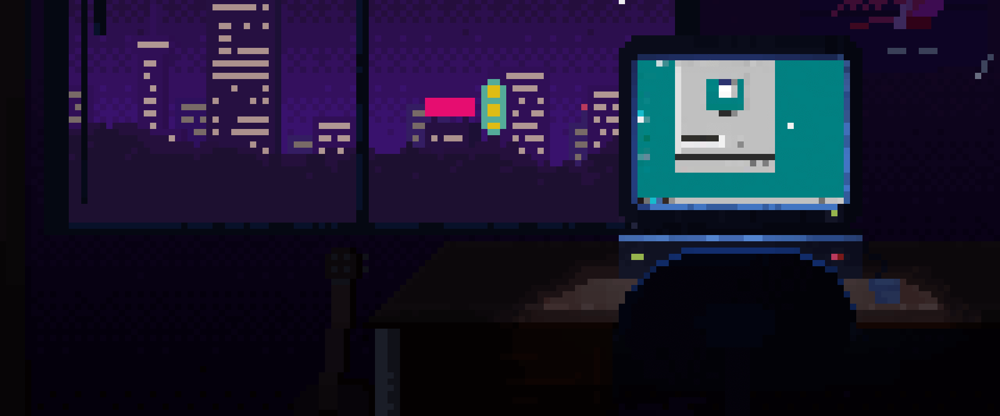
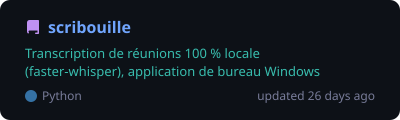
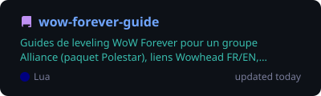
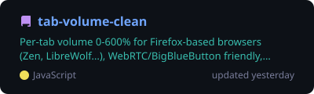
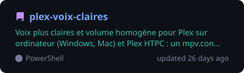
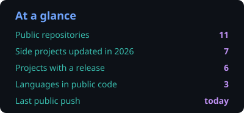

  

   

  

    

  

    I build <strong>internal business applications</strong> that make people's work simpler: replacing makeshift tools and manual processes with applications that are <strong>ergonomic, fast and designed around the people who use them</strong>. 
    💼 End to end with <strong>Laravel / Livewire</strong>: scoping with the users, design, development, CI/CD, deployment and day-to-day support. 
    🎓 Work-study <strong>software &amp; AI engineering</strong> student, soon building a <strong>RAG</strong> on an in-house AI server. 
    🛠️ <strong>HomeLab &amp; automation:</strong> self-hosted services on Linux and Docker, media stack, dashboards, and Python tools that remove repetitive work. 
    🎮 <strong>Curious by nature:</strong> gamer, bots, scrapers, video encoding… anything that involves code or creative workflows. 
    🌍 <strong>French</strong> (native), <strong>English</strong> (B2), <strong>Spanish</strong> (B2). Code speaks louder anyway.
  

  
  

 

### 🧱 Technical Stack

**Backend & Architecture (My Core)**

  
  
  
  
  
  
  
  

 

**Frontend Ecosystem**

  
  
  
  
  
  
  
  

 

**HomeLab & Automation**
*Where I merge Dev, SysAdmin & Hardware tinkering*

  
  
  
  
  
  
  

 

**Creative Tech & Side Projects**
*Where curiosity meets code: I explore everything from game bots to media workflows*

  
  
  

 

### Side projects, built for fun

Small tools I made for myself and my friends. The serious work lives in private company repositories.

<!-- projects:start -->

  
  
  
  

<!-- projects:end -->

<!-- releases:start -->

📦 Latest releases: <a href="https://github.com/BurN-30/wow-forever-guide/releases/tag/v0.9.9">wow-forever-guide v0.9.9</a> · <a href="https://github.com/BurN-30/scribouille/releases/tag/v2.4.0">scribouille v2.4.0</a> · <a href="https://github.com/BurN-30/tab-volume-clean/releases/tag/v1.3.0">tab-volume-clean v1.3.0</a> · <a href="https://github.com/BurN-30/plex-voix-claires/releases/tag/derniere-version">plex-voix-claires derniere-version</a>

<!-- releases:end -->

 

### GitHub Stats

  
  

Project cards, releases and stats are rebuilt every day by a GitHub Action.

  

 

  
   
  Served live from my homelab.

 

  

