  

   

  

    

  

    I build <strong>internal business applications</strong> that make people's work simpler: replacing makeshift tools and manual processes with applications that are <strong>ergonomic, fast and designed around the people who use them</strong>. 
    💼 End to end with <strong>Laravel / Livewire</strong>: scoping with the users, design, development, CI/CD, deployment and day-to-day support. 
    🎓 Work-study <strong>software &amp; AI engineering</strong> student, soon building a <strong>RAG</strong> on an in-house AI server. 
    🛠️ <strong>HomeLab &amp; automation:</strong> self-hosted services on Linux and Docker, media stack, dashboards, and Python tools that remove repetitive work. 
    🎮 <strong>Curious by nature:</strong> gamer, bots, scrapers, video encoding… anything that involves code or creative workflows. 
    🌍 <strong>French</strong> (native), <strong>English</strong> (B2), <strong>Spanish</strong> (B2). Code speaks louder anyway.
  

  
  

 

### 🧱 Technical Stack

**Backend & Architecture (My Core)**

  
  
  
  
  
  
  
  

 

**Frontend Ecosystem**

  
  
  
  
  
  
  
  

 

**HomeLab & Automation**
*Where I merge Dev, SysAdmin & Hardware tinkering*

  
  
  
  
  
  
  

 

**Creative Tech & Side Projects**
*Where curiosity meets code: I explore everything from game bots to media workflows*

  
  
  

 

<table>
<tr>
<td valign="top" width="50%">

#### 🔨 Recently building
<!-- building:start -->
- **[scribouille](https://github.com/BurN-30/scribouille)**: Transcription de réunions 100 % locale (faster-whisper), application de bureau Windows (updated 24 days ago)
- **[plex-voix-claires](https://github.com/BurN-30/plex-voix-claires)**: Voix plus claires et volume homogène pour Plex sur ordinateur (Windows, Mac) et Plex HTPC : un mpv.conf prêt à l'emploi (updated 24 days ago)
- **[dpln-dark-mode](https://github.com/BurN-30/dpln-dark-mode)**: Thème sombre pour Dofus pour les Noobs (updated 4 months ago)
- **[memo-price-dofus-retro](https://github.com/BurN-30/memo-price-dofus-retro)**: Mémo de prix HDV pour Dofus Retro avec OCR via NVIDIA NIM. Local-first, dossiers de farm, calcul de coût de craft. (updated 5 months ago)
<!-- building:end -->

</td>
<td valign="top" width="50%">

#### 📦 Latest releases
<!-- releases:start -->
- [scribouille v2.3.3](https://github.com/BurN-30/scribouille/releases/tag/v2.3.3) (2 months ago)
- [dpln-dark-mode v16.4](https://github.com/BurN-30/dpln-dark-mode/releases/tag/v16.4) (8 months ago)
- [LOA-Server-Status v1.0.0](https://github.com/BurN-30/LOA-Server-Status/releases/tag/v1.0.0) (13 months ago)
<!-- releases:end -->

</td>
</tr>
</table>

These two lists update themselves every day through a GitHub Action.

 

  
   
  Served live from my homelab.

 

### GitHub Stats

  
  
  

 

  

 

### Side projects, built for fun

Small tools I made for myself and my friends. The serious work lives in private company repositories.

  
  
  
  

 

  

